# i-Educar — reescrita em React + TypeScript / Django + DRF / PostgreSQL

Reescrita moderna do [i-Educar](https://github.com/portabilis/i-educar) (fork
[`michaeljcfspb/i-educar`](https://github.com/michaeljcfspb/i-educar)), o software livre
de gestão escolar usado por redes municipais no Brasil.

O sistema original é Laravel 13 + PHP 8.3 + Blade + PostgreSQL, com **2.983 arquivos PHP,
~231 mil linhas e 194 tabelas** em seis schemas. Este repositório contém a nova
arquitetura em camadas, com o domínio reconstruído em Django e a interface em React.

> **Estado:** todas as fases (0 a 5) concluídas — autenticação, pessoas/alunos, rede
> escolar, matrículas, servidores, calendário, alocação de professores, notas, recuperação,
> frequência, boletim, histórico, transferências, documentos, Censo/INEP, importação de
> planilhas, webhooks, relatórios, indicadores, portal do aluno e PDFs — com
> **86 testes automatizados** e build de produção validado.

## Stack

| Camada        | Tecnologia                                                            |
| ------------- | --------------------------------------------------------------------- |
| Frontend      | React 19 + TypeScript + Vite + Tailwind CSS + TanStack Query + Router |
| Componentes   | Biblioteca própria (`src/components/ui`) no padrão shadcn/ui          |
| Backend       | Django 5.2 + Django REST Framework 3.18                               |
| Banco         | PostgreSQL 17 (SQLite apenas nos testes)                              |
| Autenticação  | Sessão Django (cookie + CSRF) e token DRF para integrações            |
| Documentação  | OpenAPI 3 + Swagger UI (`/api/docs/`) via drf-spectacular             |
| Testes        | pytest + pytest-django (API, permissões e regras de negócio)          |
| Infra         | Docker + Docker Compose + Nginx + Easypanel                           |

## Estrutura

```
teste-REA/
├── backend/                 # Django + DRF
│   ├── apps/
│   │   ├── accounts/        # usuário, perfis, login/logout/token
│   │   ├── core/            # modelos base, estados/municípios, health
│   │   ├── people/          # pessoas, alunos, deficiências
│   │   ├── schools/         # instituição, escola, curso, série, disciplina, turma
│   │   └── enrollments/     # matrícula, enturmação, situação
│   ├── config/              # settings, urls, wsgi/asgi
│   └── tests/               # 86 testes de API/permissões/regras
├── frontend/                # SPA React + TypeScript
│   └── src/{pages,components,lib}
├── docs/                    # reconhecimento, arquitetura, API, deploy
├── docker-compose.yml
└── .env.example
```

## Telas

| Login | Painel |
| --- | --- |
| 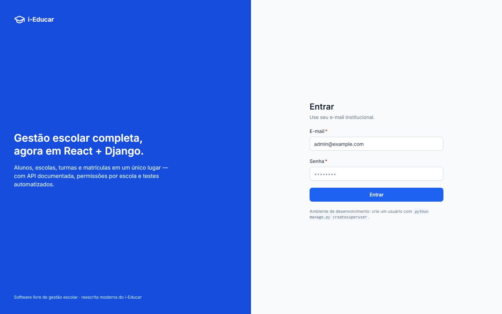 | 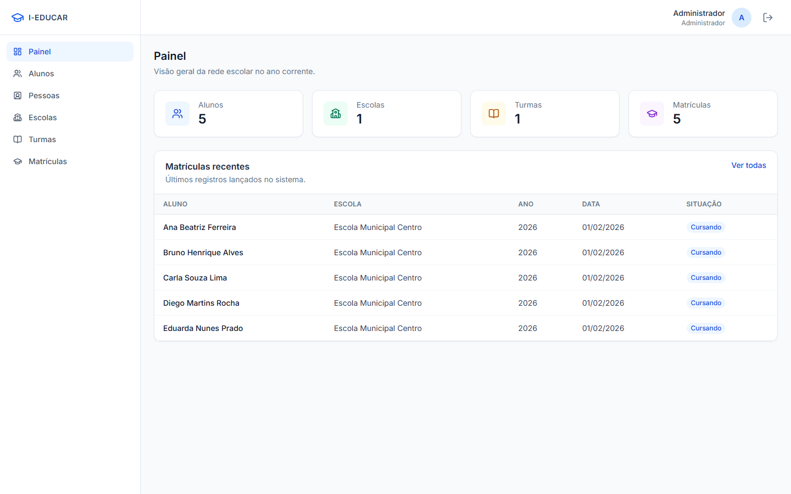 |

| Alunos | Matrículas |
| --- | --- |
| 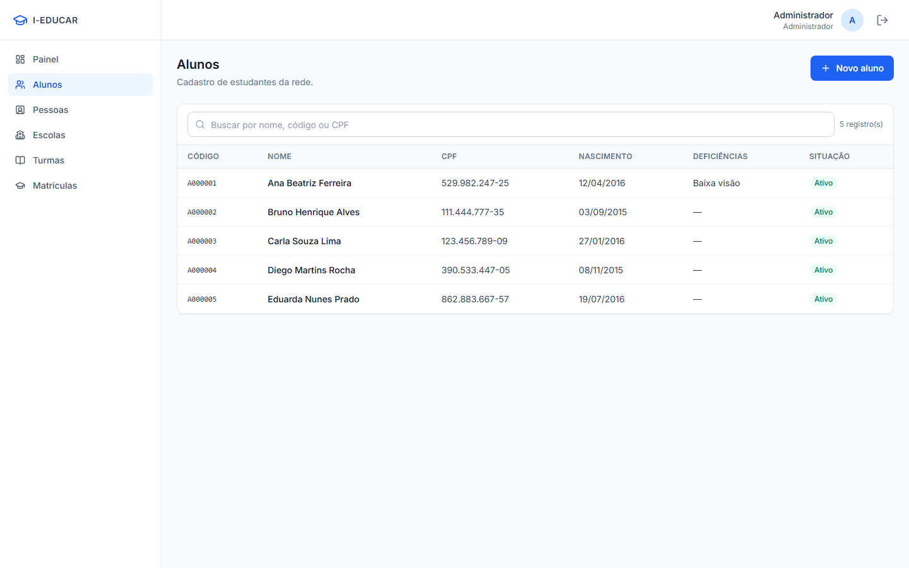 | 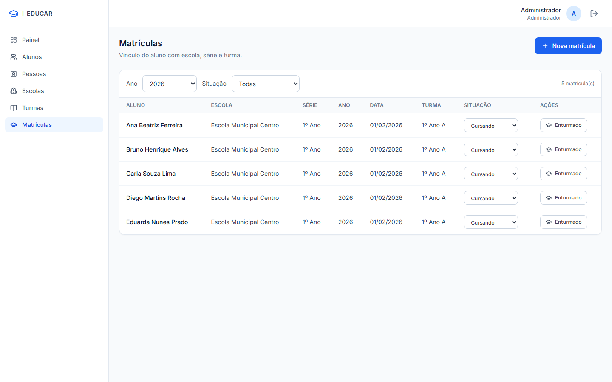 |

| Notas | Boletim |
| --- | --- |
| 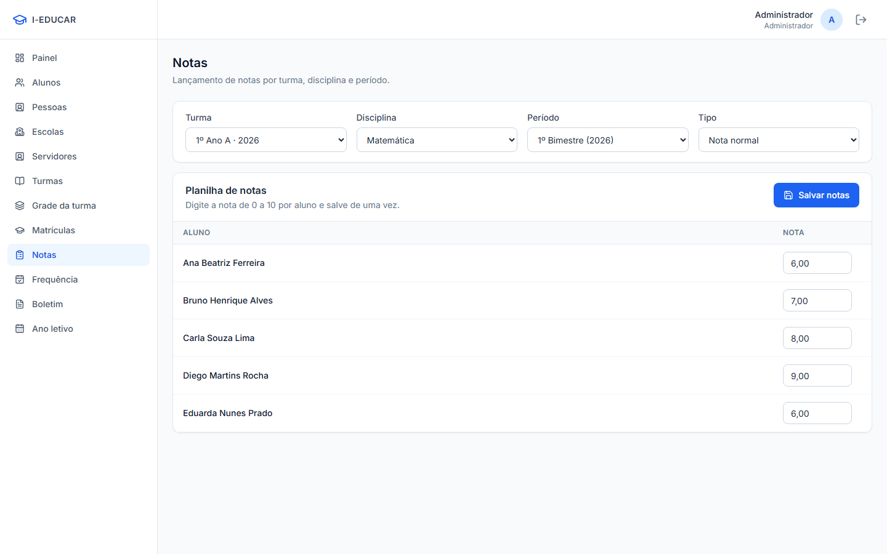 | 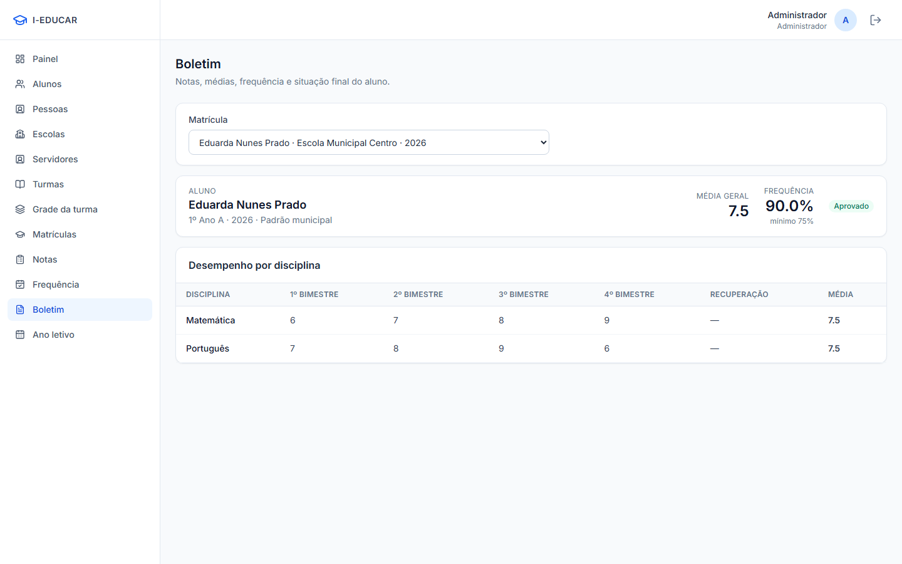 |

| Histórico escolar | Documentos |
| --- | --- |
| 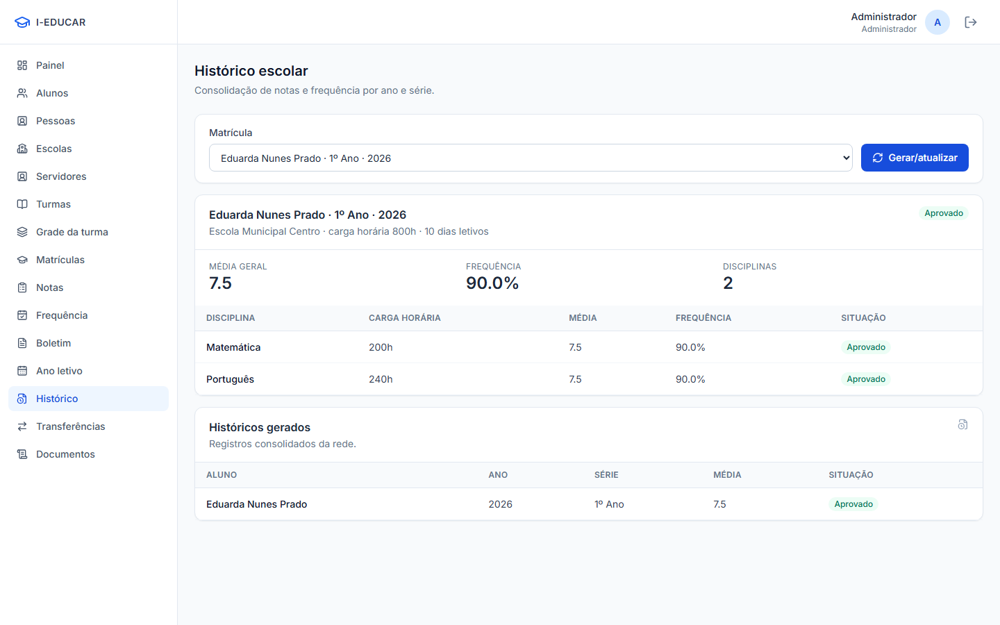 | 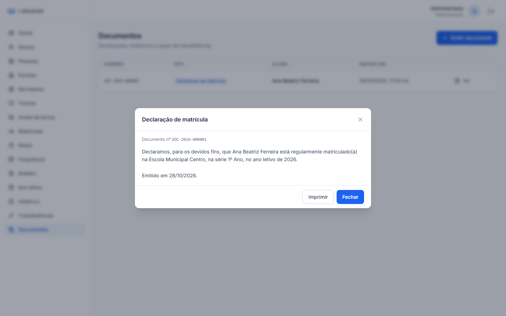 |

| Censo escolar | Importação de alunos |
| --- | --- |
| 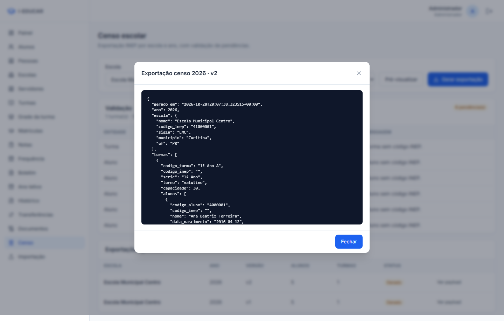 | 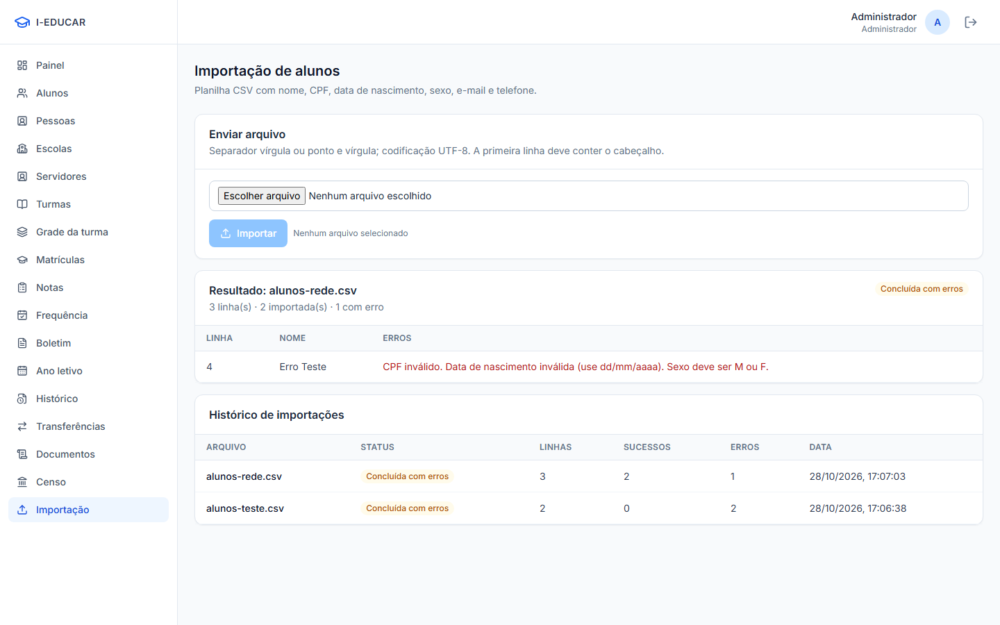 |

| Indicadores | Portal do aluno |
| --- | --- |
| 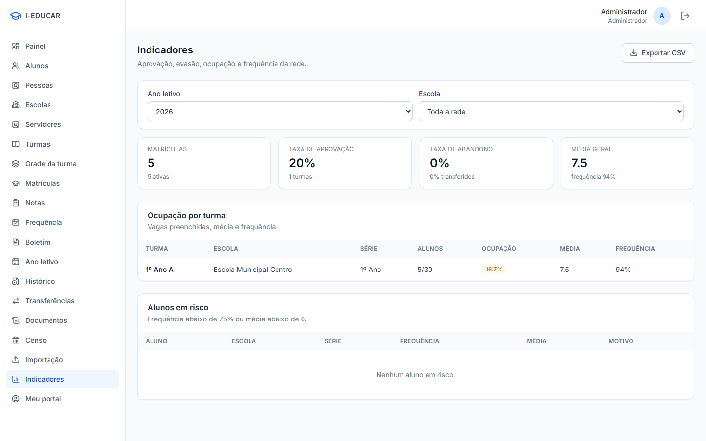 | 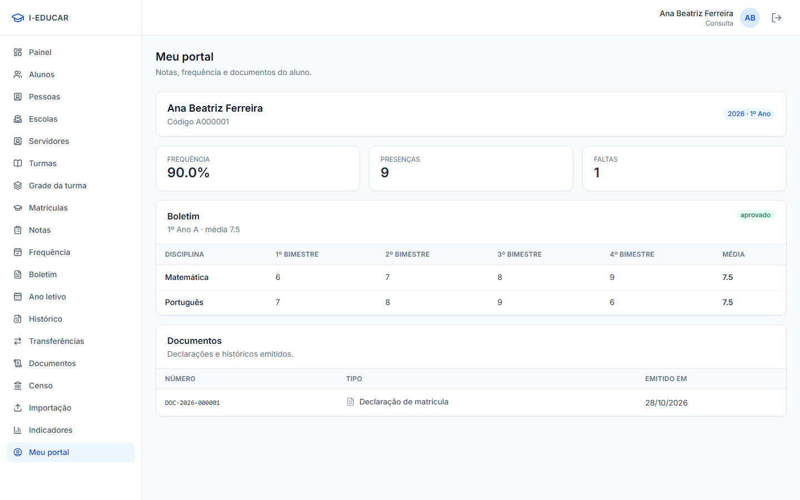 |

## Como rodar (Docker — recomendado)

```bash
cp .env.example .env        # ajuste segredos e domínio
docker compose up -d --build
docker compose exec backend python manage.py seed_demo
```

- Aplicação: <http://localhost:8080>
- Swagger: <http://localhost:8080/api/docs/>
- Admin: <http://localhost:8080/admin/>

Usuários criados pelo `seed_demo` (senha `senha-forte-123`):

| E-mail                   | Perfil        | Escopo            |
| ------------------------ | ------------- | ----------------- |
| admin@example.com        | Administrador | Toda a rede       |
| gestor@example.com       | Gestor        | Escola Municipal Centro |
| secretaria@example.com   | Secretaria    | Escola Municipal Centro |
| professor@example.com    | Professor     | Escola Municipal Centro |
| consulta@example.com     | Consulta      | Somente leitura   |

## Servidor local (um único processo, sem Docker)

O Django serve a API **e** o build do React na mesma porta — é o modo mais simples
para usar o sistema no dia a dia:

```powershell
cd C:\Users\MEDEIROS\Desktop\teste-REA
powershell -ExecutionPolicy Bypass -File .\iniciar-local.ps1
```

Acesse **http://localhost:8000** · login `admin@example.com` / `senha-forte-123`.
O script cria o `.venv` se faltar, roda as migrations, popula a demonstração
(apenas se o banco estiver vazio) e mostra também os endereços da rede local
(`http://SEU_IP:8000`) para abrir no celular/outro PC. Use `-Porta 8080` para trocar
a porta e `-SemSeed` para não popular dados.

Nesse modo quem entrega o SPA é `config/spa.py`; em Docker/Easypanel quem serve é o
Nginx. Para liberar o acesso de outros dispositivos, permita o `python.exe` no
Firewall do Windows (rede privada) quando o sistema perguntar.

## Como rodar (dev, dois servidores)

Backend:

```powershell
python -m venv .venv-backend
.\.venv-backend\Scripts\pip install -r backend\requirements-dev.txt
cd backend
$env:DB_ENGINE="sqlite"          # PostgreSQL é o padrão de produção
..\.venv-backend\Scripts\python manage.py migrate
..\.venv-backend\Scripts\python manage.py seed_demo
..\.venv-backend\Scripts\python manage.py runserver
```

Frontend (o Vite faz proxy de `/api` para `127.0.0.1:8000`, mantendo a mesma origem):

```powershell
cd frontend
npm install
npm run dev      # http://localhost:5173
```

## Testes e verificação

```powershell
cd backend
..\.venv-backend\Scripts\python -m pytest          # 86 testes
cd ..\frontend
npm run typecheck                                   # TypeScript estrito
npm run build                                       # bundle de produção
```

## API

- Base: `/api/v1/`
- Documentação interativa: `/api/docs/`
- Schema OpenAPI: `/api/schema/`
- Healthcheck (Docker/Easypanel): `/api/v1/health/`

Autenticação por sessão exige `GET /api/v1/auth/csrf/` antes do `POST /api/v1/auth/login/`
e o header `X-CSRFToken` em toda escrita. Integrações podem usar
`POST /api/v1/auth/token/` e `Authorization: Token <chave>`.

Detalhes completos em [`docs/04-api.md`](docs/04-api.md).

## Deploy

Passo a passo para Easypanel (e observações de produção) em
[`docs/05-deploy-easypanel.md`](docs/05-deploy-easypanel.md).

## Licença

O i-Educar original é licenciado sob **GPL-2.0-or-later** (© Portábilis). Esta reescrita é
uma obra derivada; o texto em [`LICENSE`](LICENSE) é a **GPL-3.0**, escolha permitida pela
cláusula "or later" da licença original. Preserve os créditos e avisos de copyright do
projeto upstream em qualquer redistribuição.
